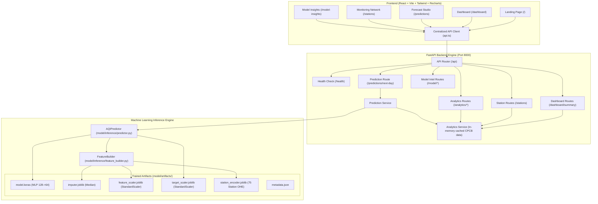

# SmartAir System Architecture

SmartAir is an enterprise-grade environmental intelligence SaaS platform for next-day Air Quality Index (AQI) forecasting.

## Architectural Highlights

1. **Separation of Concerns:**
   - `frontend/`: Single Page Application (SPA) designed with professional environmental intelligence design system.
   - `backend/`: High-performance asynchronous FastAPI REST service with Pydantic validation.
   - `model/`: Complete reproducible ML training, evaluation, and inference pipelines.
   - `data/`: Self-contained raw and processed CPCB air quality dataset.

2. **Data Leakage Mitigation:**
   - 7-day lookback sequence generation strictly partitioned by target date.
   - Training dates: Through 2018-11-06 (70% calendar dates).
   - Validation dates: 2018-11-06 to 2019-09-03 (15% calendar dates).
   - Test dates: 2019-09-03 to 2020-07-01 (15% calendar dates).
   - Preprocessing transformers (imputer, feature scaler, target scaler) fitted strictly on training data.
   - `AQI_Bucket` deliberately omitted to prevent circular leakage.

3. **Inference Pipeline:**
   - Receives station identifier and target prediction date.
   - Validates existence and strict continuity of 7 preceding consecutive days.
   - Reconstructs cyclical date features (sine/cosine of day of year and month).
   - Imputes and scales features using the saved training artifacts.
   - Outputs continuous AQI prediction, classified into Indian National AQI bands.

